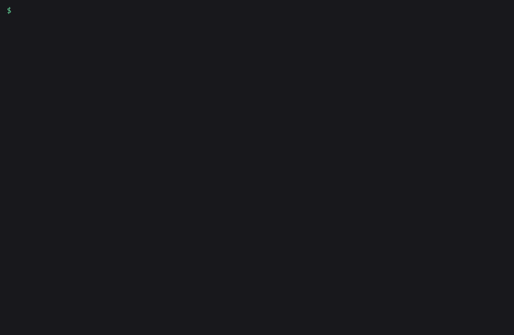

# amagi-env-check

Compare `.env`, `.env.example` and the environment your app actually runs with on Vercel, Railway or Fly. It lists the keys that are missing, extra, empty or defined twice, and it never prints a value.



## Install

```bash
pipx install amagi-env-check
```

Python 3.9 or newer. No dependencies.

## Usage

Run it from your project folder. With no options it compares `.env` (or `.env.local`) against `.env.example`:

```bash
amagi-env-check
```

Add the live environment by letting it call the platform CLI you are already logged in to:

```bash
amagi-env-check --run vercel
```

Real output from the Next.js example that ships in this repo, using a saved `vercel env ls production` table:

```bash
cd examples/nextjs-app
amagi-env-check --live vercel-env-ls.txt
```

```
Compared 3 sources: .env.example (9 keys), .env.local (8 keys), vercel (7 keys, names only)

MISSING IN vercel  listed in .env.example, not in vercel
  RESEND_API_KEY
  STRIPE_WEBHOOK_SECRET

MISSING IN .env.local  listed in .env.example, not in .env.local
  RESEND_API_KEY

EXTRA IN vercel  in vercel, not listed in .env.example
  LEGACY_API_TOKEN

EXTRA IN .env.local  in .env.local, not listed in .env.example
  DEBUG_SQL  line 8

EMPTY IN .env.local  present with an empty value
  NEXT_PUBLIC_POSTHOG_KEY  line 7

DUPLICATE IN .env.local  defined more than once; the last one wins
  DATABASE_URL  lines 1, 9

7 problems (3 missing, 2 extra, 1 empty, 1 duplicate) across 11 keys. No values were printed.
```

The exit code is 1 because problems were found. Missing keys in the live source come first, because those are the ones that break a deploy.

Add `--matrix` to see every key against every source:

```
KEY                                 .env.example  .env.local  vercel
DATABASE_URL                        listed        set         present
DEBUG_SQL                           -             set         -
LEGACY_API_TOKEN                    -             -           present
NEXTAUTH_SECRET                     listed        set         present
NEXTAUTH_URL                        listed        set         present
NEXT_PUBLIC_POSTHOG_KEY             listed        empty       present
NEXT_PUBLIC_STRIPE_PUBLISHABLE_KEY  listed        set         present
RESEND_API_KEY                      listed        -           -
SENTRY_DSN                          optional      -           -
STRIPE_SECRET_KEY                   listed        set         present
STRIPE_WEBHOOK_SECRET               listed        set         -
```

`present` means the platform lists the key but hides its value, so the tool can't tell whether it is empty. `optional` comes from a commented `# SENTRY_DSN=` line in the example file: the key is documented, and leaving it out is fine.

## The live environment

There are two ways in. `--run` calls the platform CLI for you. `--live` reads output you saved or piped, so you can run the CLI however you like.

### Vercel

```bash
amagi-env-check --run vercel                      # production
amagi-env-check --run vercel --target preview
vercel env ls production | amagi-env-check --live -
```

`--run vercel` uses `vercel env ls <target> --format json` and falls back to the plain table on older CLIs. Vercel only returns names here, never values.

### Railway

```bash
amagi-env-check --run railway
amagi-env-check --run railway --run-args "--service api"
railway variable list --json > live.json && amagi-env-check --live live.json
```

`--run railway` uses `railway variable list --json` and falls back to `railway variables --json`. Railway does return values. The tool reads each one only to check whether it is empty, then drops it. Sealed variables count as present.

### Fly

```bash
amagi-env-check --run fly --run-args "-a my-app"
fly secrets list -a my-app | amagi-env-check --live -
```

`--run fly` uses `fly secrets list --json` (or `flyctl`). Fly returns names and digests, never values.

### Anything else

`--live` also takes a flat JSON object, a JSON list of `{"name": ...}` items, or a plain dotenv file such as the one `vercel env pull` writes. Use `--live-format` if auto-detection guesses wrong, and `--live-name` to change the label in the report.

## The four categories

- **missing:** the example file lists the key, and this source doesn't have it. With no example file, `.env` becomes the reference, and keys that only the live source has show up as missing from `.env`.
- **extra:** the source has a key that the example file never mentions. Either document it or delete it.
- **empty:** the key is there with nothing after the `=`. A key that is optional in the example file is allowed to be empty.
- **duplicate:** the key is defined twice in one file. Most loaders keep the last one, which is rarely what you meant.

## Options

```bash
amagi-env-check path/to/project            # compare another folder
amagi-env-check --env .env.production      # pick the local file
amagi-env-check --example .env.sample      # pick the example file
amagi-env-check --no-env --run vercel      # example vs live only
amagi-env-check --matrix                   # add the key-by-source table
amagi-env-check --format json              # findings as JSON
amagi-env-check --ignore 'DEBUG_*'         # skip a key or glob (repeatable)
amagi-env-check --fail-on missing,empty    # only these categories fail the run
amagi-env-check --fail-on none             # report, always exit 0
```

Keys the platforms inject on their own (`VERCEL`, `VERCEL_*`, `TURBO_*`, `NX_DAEMON`, `RAILWAY_*`, `FLY_*`) are skipped in `.env` and the live source unless your example file lists them, so a file written by `vercel env pull` doesn't flag `VERCEL_OIDC_TOKEN`. `--no-default-ignore` keeps them. For keys you want to silence for good, put one name or glob per line in a `.envcheckignore` file in the project folder.

Exit codes: 0 means no problems, 1 means problems were found, 2 means a usage or input error.

## What it never does

It never prints, logs or stores a value. Parsers read a value only to decide whether it is empty, and the result holds key names and line numbers, nothing else. A warning about a malformed line gives the line number, and the key when there is one. The test suite plants a sentinel value in every input format that carries values (dotenv, JSON, the Railway table) and fails if it shows up anywhere in text, matrix or JSON output, or on stderr.

It doesn't change anything either. `--run` only calls the read-only list command for each platform.

## Use it from Claude Code

This repo ships a skill at `.claude/skills/amagi-env-check/SKILL.md`. Copy that folder into your own `.claude/skills/` and Claude Code can run the diff before a deploy, read the JSON, and tell you which keys to add where.

## Limits

- Vercel and Fly never return values, so `empty` can't be checked for those sources. Railway can, except for sealed variables.
- `--run` needs the platform CLI on your PATH, logged in and linked to the project. When the CLI fails, the tool exits 2 and shows the last lines of its error.
- Vercel `--target` matches the environment column, so custom environments work only if the name appears there.
- It compares one live environment per run. To check preview and production, run it twice.
- Dotenv parsing follows the common rules (quotes, `export`, inline `#` comments, multi-line double quotes). Variable expansion such as `${OTHER}` is not resolved, which doesn't matter for an empty check.

## If this saved you time

A star helps other people find it.

## More from AmagiLabs

- [amagilabs](https://github.com/amagilabs): other small open source dev tools from the same lab.
- [amagi-envdrift](https://github.com/amagilabs/amagi-envdrift): find the env vars your code reads that `.env.example` never mentions.
- [amagi-watch](https://github.com/amagilabs/amagi-watch): turn a video URL into a Claude-readable transcript and frame index.
- [amagi-legal-review-skills](https://github.com/amagilabs/amagi-legal-review-skills): Claude Code skills for contract and lease review.

## License

MIT, see [LICENSE](LICENSE). Copyright (c) 2026 Amagisolutionsgroup, Inc. (AmagiLabs)
